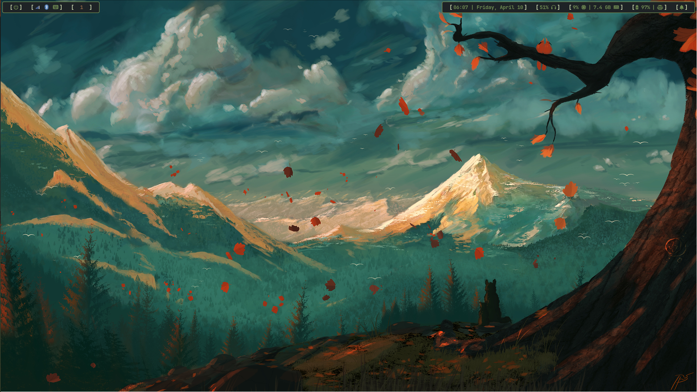

# Screenshots



# Components

window manager: hyprland
terminal: kitty
gtk theme: everforest (the overall color scheme is also based on this)
file manager: nautilus
bar: waybar
menu: rofi 
lock screen: hyprlock
notifications center: swaync
wallpaper: ewww

# Laptop power saving

The control panel uses power-profiles-daemon. Power saver selects the laptop's
tested 1920x1200 60 Hz timing; leaving power saver restores its highest advertised
refresh rate (144 Hz). External displays retain their highest supported modes.
The policy also runs after monitor hotplug and Hyprland config reloads.

The audio visualizer runs only while the control panel is open.

TTY1 starts Hyprland through `scripts/start-hyprland.sh`, which discovers the AMD
GPU at login and makes it the primary renderer. NVIDIA remains available for HDMI
and explicit `prime-run` applications. GPU selection takes effect on the next
login; Hyprland cannot move a running compositor or existing apps between GPUs.
AMD rendering does not guarantee that NVIDIA sleeps if an app or HDMI needs it.

# App appearance

Shine Everforest uses Kitty's cream foreground (`#d3c6aa`) and background
(`#1e2326`), plus the green, blue and orange accents in the shared bar CSS.

After editing `.config/themes/shine-theme-kitty.conf` or `shine-theme.css`, run:

```sh
/usr/bin/python3 ~/dotfiles/scripts/apply_app_theme.py
```

This regenerates GTK 3, GTK 4/libadwaita, Qt 5/6 and Edge palettes, installs their
configuration links, and selects dark mode through desktop/portal settings.
Previous desktop settings are saved under `~/.local/state/shine-theme/`.
Existing configuration links replaced during installation are backed up there.

Reopen applications to load changed CSS or palettes. The GTK 4 override changes
color tokens while keeping the app's own widget layout. Qt apps use Fusion with
the custom palette; the `qt5ct` plugin name works with both installed Qt versions.
Papirus-Dark supplies the app icons.

Edge loads `.config/edge-theme/manifest.json` through its existing launcher flags
file at the next full browser start. This is a local, color-only theme with no
scripts or permissions. Website content and some Edge-specific pages still use
their own styling; a browser theme controls the browser UI, not arbitrary sites.

For a new machine, install `qt5ct`, `qt6ct`,
`xdg-desktop-portal-gtk`, `papirus-icon-theme`, and the app/toolkit dependencies.
Do not set `GTK_THEME` globally: the modern GNOME apps use their libadwaita
palette overrides and the portal's dark-mode preference instead.
